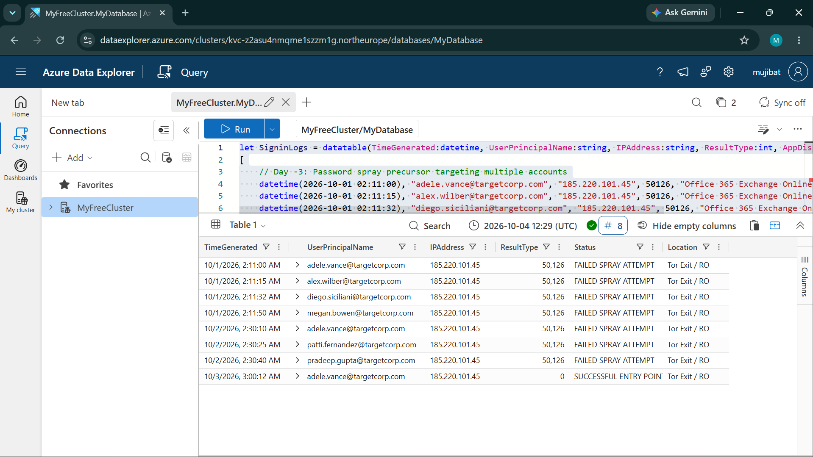
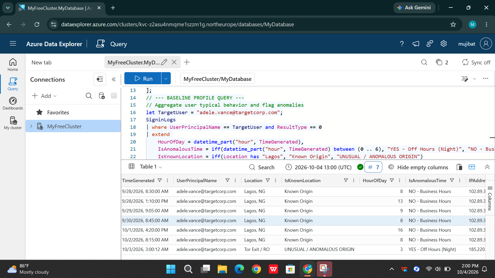
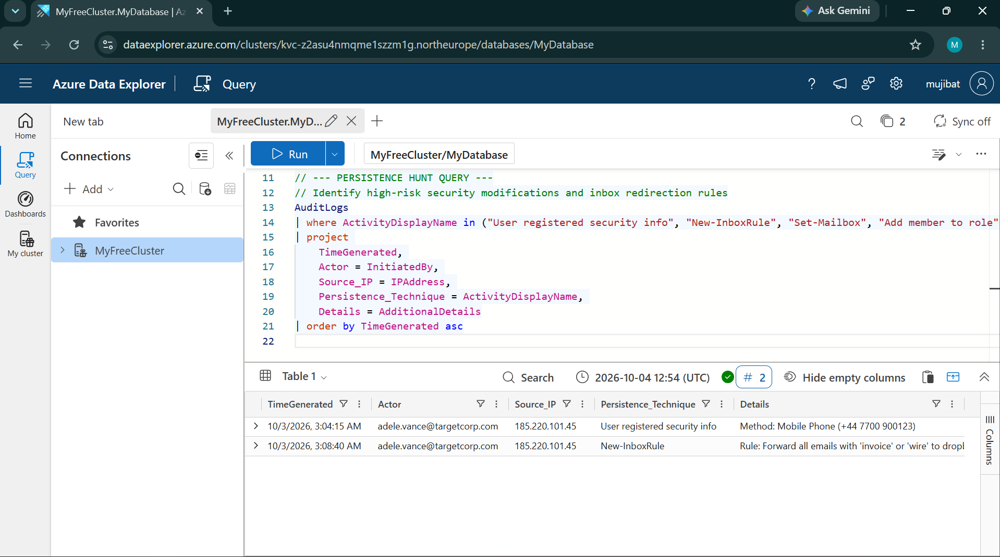

# Cloud Incident Response & Threat Hunting: Triaging Account Takeover (ATO) with KQL


---

## Executive Summary

This project walks through a full SOC triage of an account takeover, using KQL in Azure Data Explorer to go from a single anomaly alert to a complete picture of what the attacker did.

The target is an executive identity, `adele.vance@targetcorp.com`. The investigation starts with a low and slow password spray campaign, moves into behavioral baselining to confirm the compromise wasn't just unusual travel, and ends with uncovering two separate persistence mechanisms the attacker planted after getting in.

---

## MITRE ATT&CK Mapping

| Tactic | Technique ID | Technique Name |
| :--- | :--- | :--- |
| Initial Access | `T1110.003` | Password Spraying |
| Initial Access | `T1078.004` | Valid Accounts: Cloud Accounts |
| Defense Evasion | `T1556` | Modify Authentication Process (Rogue MFA Registration) |
| Collection / Exfiltration | `T1114.001` | Email Collection: Local Email Collection (Inbox Forwarding Rules) |

---

## Technical Investigation & Evidence

### 1. Reverse Threat Hunting: Correlating Initial Access

After the initial anomaly alert came in, I traced authentication activity backward across the previous few days to find whatever led up to it. That turned up a distributed password spray campaign coming from a Tor exit node (`185.220.101.45`), hitting multiple user accounts with failed logons (`ResultType == 50126`, invalid credentials) before finally landing one successful login on Adele's account.

```kql
let SprayIP = "185.220.101.45";
SigninLogs
| where IPAddress == SprayIP
| project TimeGenerated, UserPrincipalName, IPAddress, ResultType,
          Status = iff(ResultType == 0, "SUCCESSFUL ENTRY POINT", "FAILED SPRAY ATTEMPT"),
          Location
| order by TimeGenerated asc
```



---

### 2. Behavioral Profiling & Anomaly Detection

Before calling this a compromise, I needed to rule out something boring, like approved executive travel. So I built a behavioral baseline from Adele's historical sign in data.

That baseline showed consistent hours (08:00 to 17:00, UTC+1) and a consistent origin, Lagos, Nigeria (`102.89.34.12`). The session in question broke the pattern on every axis that mattered: it happened at 3:00 AM, it came from Romania through a Tor exit node, and the infrastructure itself (public anonymization network) had no business touching an executive account.

```kql
let TargetUser = "adele.vance@targetcorp.com";
SigninLogs
| where UserPrincipalName == TargetUser and ResultType == 0
| extend
    HourOfDay = datetime_part("hour", TimeGenerated),
    IsAnomalousTime = iff(datetime_part("hour", TimeGenerated) between (0 .. 6), "YES - Off Hours (Night)", "NO - Business Hours"),
    IsKnownLocation = iff(Location has "Lagos", "Known Origin", "UNUSUAL / ANOMALOUS ORIGIN")
| project TimeGenerated, UserPrincipalName, Location, IsKnownLocation, HourOfDay, IsAnomalousTime, IPAddress
| order by TimeGenerated asc
```



---

### 3. Post-Compromise Persistence & Exfiltration Audit

A password reset alone doesn't close an incident like this. I queried Entra ID and Exchange `AuditLogs` to see what the attacker actually did once inside, and found two separate persistence mechanisms planted within minutes of the initial login, both from the same Tor exit node.

First, a rogue MFA enrollment at 3:04 AM. The attacker added an unauthorized phone number (`+44 7700 900123`), which would have let them back in even after a password reset. Second, at 3:08 AM, a hidden inbox rule built to auto forward any email mentioning "invoice" or "wire" to an external address, then quietly delete the original from the inbox.

```kql
AuditLogs
| where ActivityDisplayName in ("User registered security info", "New-InboxRule", "Set-Mailbox", "Add member to role")
| project
    TimeGenerated,
    Actor = InitiatedBy,
    Source_IP = IPAddress,
    Persistence_Technique = ActivityDisplayName,
    Details = AdditionalDetails
| order by TimeGenerated asc
```



---

## Containment & Remediation Plan

| Priority | Action Item | Technical Execution |
| :--- | :--- | :--- |
| P0 (Critical) | Session Revocation | Revoke all active tokens: `Revoke-AzureADUserAllRefreshToken -ObjectId <Adele_GUID>` |
| P0 (Critical) | Purge Rogue Factors | Remove the unauthorized phone factor (`+44 7700 900123`) from the user's Entra ID Authentication Methods blade |
| P1 (High) | Remove Mailbox Rules | `Remove-InboxRule -Mailbox "adele.vance" -Identity "<Rule_ID>"` via Exchange Online PowerShell |
| P1 (High) | Credential Reset | Force an out of band password reset with a temporary access pass |
| P2 (Medium) | Perimeter Hardening | Block the malicious Tor exit IP `185.220.101.45` and enforce Conditional Access policies against anonymous IP tiers |

---

## Key Takeaways

Password spraying isn't brute forcing. Attackers spread login attempts across many accounts over several days specifically to stay under the radar of lockout thresholds built for faster, noisier attacks.

Closing the ticket after a password reset isn't enough either. Real containment means checking the identity provider logs and mailbox configuration too, because that's exactly where this attacker left a way back in.
